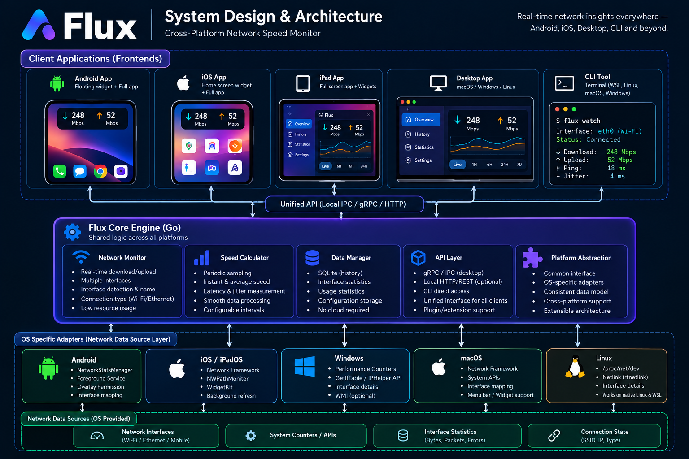

# Flux

**Your network. At a glance.**~

Flux is a planned cross-platform network speed monitor for developers
and everyday users. It combines a minimal floating speed pill, an
expandable statistics panel, and a command-line interface (CLI) for
terminal-first workflows.

> **Status:** Planning / early development. The images in this README
> are product concept mockups, not screenshots of a finished
> implementation.
~
## System Design & Architecture
~


Flux is designed around a local-first monitoring core and
platform-specific adapters. Each client reads network statistics using
the APIs available on its operating system. Shared logic calculates
traffic rates and provides consistent data to the graphical interface
and CLI.

## UI Design --- All Platforms


The UI direction uses a tiny floating pill by default, with an
expandable panel for more detail. On platforms that do not support
general-purpose floating overlays, Flux will use supported widgets and
in-app views.

## Product Goals

-   **At-a-glance monitoring:** Show download and upload traffic without
    interrupting the user's workflow.
-   **Minimal by default:** Keep the collapsed widget small and
    unobtrusive.
-   **Detailed when needed:** Provide graphs, interface details, latency
    measurements, and usage history in the expanded view.
-   **Terminal friendly:** Provide a CLI for WSL, Linux, macOS, Windows,
    and SSH workflows where supported.
-   **Local-first and privacy-aware:** Core monitoring does not require
    an account or cloud service.
-   **Cross-platform:** Share data models and calculations while using
    native OS integrations where necessary.

## Planned Features

-   Live download and upload traffic.
-   Floating overlay and expand/collapse interaction on supported
    platforms.
-   Network interface name and connection details where the OS exposes
    them.
-   Optional ping and jitter measurements.
-   Live traffic graph and local usage history.
-   Configurable display units, refresh interval, transparency, and
    position.
-   CLI commands for current status, continuous monitoring, interfaces,
    and history.
-   Optional future cloud synchronization, only if there is a real need.

## Planned CLI

``` bash
flux watch
flux status
flux interfaces
flux history
flux test
```

  Command             Purpose
  ------------------- -------------------------------------------------------
  `flux watch`        Continuously display current traffic.
  `flux status`       Print a one-time status snapshot.
  `flux interfaces`   List available network interfaces.
  `flux history`      Display locally stored traffic history.
  `flux test`         Run an on-demand internet speed test, if implemented.

These commands describe the planned interface and may not work until
implemented.

## Planned Technology Stack

  -----------------------------------------------------------------------
  Component                           Planned technology
  ----------------------------------- -----------------------------------
  Android app UI                      React Native

  Android overlay and OS integration  Kotlin and Android APIs

  Desktop UI                          React + TypeScript + Tauri

  Desktop window and system           Native OS APIs
  integration                         

  iOS / iPadOS app                    React Native with SwiftUI /
                                      WidgetKit integration

  CLI                                 Go

  Shared monitoring logic             Reusable core logic and
                                      platform-specific adapters

  Local storage                       SQLite or platform-native storage

  Backend                             Optional Go API for future cloud
                                      features

  Cloud database                      PostgreSQL only if cloud
                                      persistence is needed
  -----------------------------------------------------------------------

A shared core can reuse models and rate calculations, but OS-specific
network access, overlays, and widgets still require native integrations.

## Architecture Principles

1.  **Measure locally:** Do not send every live sample to a remote
    server.
2.  **No account required:** Core monitoring should work without
    authentication.
3.  **Reuse where practical:** Share data models and calculations across
    clients.
4.  **Respect platform rules:** Provide overlays only where supported
    and permitted.
5.  **Keep it lightweight:** Minimize CPU, memory, battery, and network
    overhead.
6.  **Protect privacy:** Make sensitive details such as IP addresses
    optional.
7.  **Add backend only when needed:** Cloud sync, accounts, and remote
    monitoring are future options, not MVP requirements.

## Platform Considerations

-   **Android:** A floating overlay requires user-granted permission and
    careful background execution handling.
-   **Windows and macOS:** Native always-on-top windows are feasible
    with platform-specific integrations.
-   **Linux:** Window behavior can vary by desktop environment and
    window manager.
-   **iPhone and iPad:** Use supported home-screen widgets and in-app
    views. A general-purpose floating overlay over every app is not
    available.
-   **WSL:** Traffic visible inside WSL may differ from total Windows
    network traffic. Interface names such as `eth0` are
    environment-dependent.

## Planned Repository Structure

``` text
Flux/
├── apps/
│   ├── mobile/                 # React Native application
│   └── desktop/                # React + Tauri application
├── packages/
│   └── shared/                 # Shared types and utilities
├── cli/                        # Go CLI
├── core/                       # Shared logic where practical
├── backend/                    # Optional Go cloud API
├── assets/
│   ├── systemDesign.png
│   └── UiDesign.png
├── docs/
├── LICENSE
└── README.md
```

This is a proposed structure; add directories as implementation begins
rather than creating everything at once.

## Development Roadmap

1.  Implement and test local network-rate calculations.
2.  Build the Android MVP: monitoring, small overlay, and expanded
    panel.
3.  Build the Go CLI for terminal users.
4.  Add desktop clients and native floating-window support.
5.  Add iOS/iPadOS widgets and app views.
6.  Evaluate user feedback before adding cloud features.

## Contributing

Contributions, bug reports, and feature suggestions are welcome. Before
opening a pull request, describe the change and test it on the target
platform where possible.

## License

Flux is licensed under the MIT License. See [LICENSE](LICENSE) for
details.
